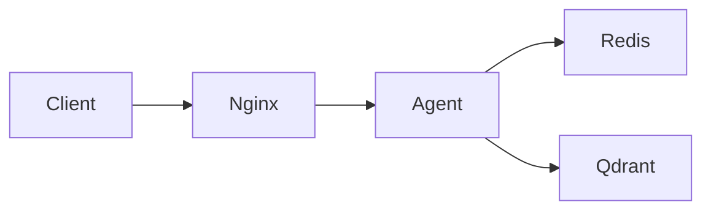

# Day 14 — Mission Answers

Evidence below was generated by this repository on 25 November 2026 (GMT+7).
Follow the K5 checkpoint order in `CHECKPOINTS.md`: Parts 1, 2, 4, 5, 6, 3, 7.

## Part 1 — Localhost vs Production

### Exercise 1.1 — Anti-patterns

In `01-localhost-vs-production/develop/app.py`:

1. `OPENAI_API_KEY` and `DATABASE_URL` embed credentials in source control.
2. `print(...OPENAI_API_KEY...)` exposes the key in logs.
3. `DEBUG = True` and `reload=True` enable development behavior in deployment.
4. `host="localhost"` prevents access through a container's external network interface.
5. `port=8000` ignores a cloud platform's injected `PORT`.
6. No `/health` or `/ready` endpoint exposes process/dependency readiness.
7. No lifecycle cleanup documents how resources are released on shutdown.
8. No authentication, rate limit, or cost protection guards the LLM endpoint.

### Exercise 1.2 — Run the develop app

Executed `POST /ask?question=Hello` → 200. JSON-only input → 422 because this version expects a query parameter.
The example runner starts Uvicorn on a free port to avoid collisions. See [actual HTTP output](reports/local-examples.txt).

### Exercise 1.3 — Comparison

| Feature | Develop | Production example | Why it matters |
|---|---|---|---|
| Config | Fixed constants | Environment-backed `Settings` | Same image can use different deployment configuration |
| Binding | localhost:8000 | Configurable host/port, default 0.0.0.0 | Reachable from container networking/platform ingress |
| Probes | Absent | `/health` and `/ready` | Separate restart decisions from routing decisions |
| Logging | print, including credentials | Logging with request metadata and JSON-shaped messages | Searchable diagnostics without secret exposure |
| Shutdown | No application cleanup | Lifespan cleanup | Release connections after in-flight work drains |
| Reload | Always on | Controlled by debug setting | Avoid development reload processes in production |

The example has limitations: its formatter interpolates JSON strings into a JSON-shaped log message without escaping, and its LLM call blocks an async route. Part 6 uses `json.dumps` formatting and a synchronous route executed by FastAPI's thread pool. Uvicorn owns SIGTERM; Part 6 does not replace its handler.

## Part 2 — Docker

### Exercise 2.1 — Dockerfile questions

1. Base image: `python:3.11` in the develop Dockerfile.
2. Working directory: `/app`.
3. Copy requirements before source so source edits reuse the dependency-install layer.
4. `CMD` supplies the default command/arguments and can be overridden by `docker run`; `ENTRYPOINT` fixes the executable, with CMD often supplying its default arguments. Exec form enables direct signal delivery; a shell wrapper must `exec` the server.

### Exercises 2.2–2.3 — Build and size

Both images were built from the repository root using `-f 02-docker/{develop,production}/Dockerfile`.
Measured sizes and reduction are in the final evidence section below; raw bytes: [image-sizes.txt](reports/image-sizes.txt).
The develop image was run on an automatically assigned localhost port; `POST /ask?question=What%20is%20Docker%3F` returned 200. See [container HTTP evidence](reports/docker-develop-http.txt). The container was stopped afterward.
Develop uses the full Python base. Production installs dependencies in a builder and copies runtime packages into a slim image, omitting GCC/build tools. It also uses a non-root user and health check.

### Exercise 2.4 — Compose architecture



The stack uses its own internal network. Redis and Qdrant have readiness health checks; Nginx exposes the ingress ports and forwards to the agent. The agent example configures Redis/Qdrant addresses, though the mock question handler does not perform retrieval.
Executed `GET /health` and `POST /ask` through Nginx, both 200: [HTTP evidence](reports/docker-stack-http.txt).
Used project name `k5-day14-docker` to avoid colliding with the other `production` directories; stopped it after recording results.

## Part 3 — Cloud deployment

### Exercises 3.1–3.2 — Railway primary, Render comparison

Railway was selected. Deployable source/configuration is complete in `06-lab-complete/`.
Public URL: https://agent-production-8e366087.up.railway.app. Railway reports deployment `SUCCESS`; the four CP6 checks returned 200, 200, 401 and 200. See [DEPLOYMENT.md](DEPLOYMENT.md) and [actual public HTTP checks](reports/deployment-http.txt).

| Item | Railway TOML | Render YAML |
|---|---|---|
| Scope | Configures the linked agent service build/deploy | Blueprint declares web services and environment entries |
| Container | `builder="DOCKERFILE"` | `runtime: docker` |
| Probe | `healthcheckPath="/health"` | `healthCheckPath: /health` |
| Secrets | Set in Railway service variables | `generateValue: true` or `sync: false` |
| Redis | Add database service, reference its URL | Provision Redis separately and set URL, or extend Blueprint |
| Monorepo | Root directory `/06-lab-complete` | Blueprint/context paths must resolve to Part 6 |

### Exercise 3.3 — Cloud Run pipeline (read-only)

`cloudbuild.yaml` declares dependency installation and pytest, then builds a Docker image tagged by commit SHA and `latest`.
The build step waits for tests; push waits for build, and deployment waits for push.
The final step deploys that image to Cloud Run with region/resource/scaling flags and a Secret Manager reference.
`service.yaml` describes the service's container, secret references, probes, concurrency and instance bounds as infrastructure configuration.
These example files were inspected, not deployed; project-specific IDs, test paths and service settings need a real GCP project.

## Part 4 — API security

### Exercises 4.1–4.3 — Measured results

The API-key demo returned 401 without a key and 200 with a generated key.
The JWT demo issued a token via `/auth/token` for the supplied demo student account. The token was kept in memory and redacted from evidence.
The first ten JWT requests returned 200; requests 11 and 12 returned 429 with `Retry-After`.
Full sanitized response headers/bodies: [local-examples.txt](reports/local-examples.txt).

The supplied basic demo returns 403 for an incorrect key. Part 6 follows the grading contract and returns 401 for both missing and incorrect keys.
JWT includes a signed identity and expiry; API keys are shared opaque secrets. JWT signature verification must fix the permitted algorithm and reject expired tokens.

### Exercise 4.4 — Cost guard

Before the LLM call, check global daily and monthly Redis spending; at or above either budget return 402.
After a successful response, estimate mock tokens and atomically increment counters using a Redis transaction.
Daily keys use UTC dates; monthly keys use UTC months; expiration removes historical counters.
The rate limit controls requests per minute, while the cost guard controls token spending. Both are needed because calls have different token costs.
The lab implementation checks cost before each call; concurrent in-flight calls can exceed the remaining budget by their combined cost. Strict financial ceilings would require atomic preauthorization/reservations and reconciliation with provider-reported usage.

## Part 5 — Scaling & reliability

### Exercise 5.1 — Health and readiness

Liveness means the process can respond; dependency loss must not cause unnecessary restart loops.
Readiness means the instance can serve real requests and requires Redis for this agent.
The example probes returned 200. The Part 6 grader additionally verified Redis unavailable → `/ready` 503 while `/health` remains 200.

### Exercise 5.2 — Graceful shutdown

Uvicorn receives SIGTERM, stops accepting traffic, drains work and invokes lifespan cleanup to close Redis.
The actual Part 6 checks verified an in-flight request still returned 200 and the process exited 0. Docker stop timing is recorded in the grading output.

### Exercise 5.3 — Stateless design

Conversation history stored in a Python dictionary would be private to one process and lost on restart.
Redis provides the shared state so different workers/containers observe the same session.
Part 6 also stores rate-limit and budget state in Redis; neither relies on process memory.

### Exercises 5.4–5.5 — Three-instance test

Started `docker compose -p k5-day14-scaling up -d --build --scale agent=3` from the supplied production directory.
Ran `test_stateless.py` through `localhost:8080/chat`: five questions reached three different instances; all ten user/assistant messages remained in shared history.
Actual instance IDs and messages: [stateless-scaling.txt](reports/stateless-scaling.txt).
The supplied test verifies cross-instance history; it does not stop an instance. No failover experiment is claimed for this step.
Stopped the stack using the same Compose project name after collecting evidence.

## Part 6 — Production-ready agent

Implemented the scaffold in place, keeping the grading script unchanged:

- Environment configuration and constant-time API-key checks; empty/missing configuration never grants access.
- Lazy Redis connections; dependency failure becomes 503 rather than exposing a stack trace.
- Atomic Lua sliding-window limits using Redis server time, hashed key identifiers and unique request members.
- Daily/monthly shared cost accounting, input validation, structured JSON request logs.
- Uvicorn-managed shutdown, multi-stage slim Docker image, non-root runtime and health check.
- Redis persistence in Compose; Railway configuration and alternative Render configuration.

The full unchanged grader reports **PASS 12/12, 43/43 checks passed**. See the copied checklist and output below.

## Measured Docker size and final checklist

Develop: 1154311846 bytes (1100.84 MiB). Production: 162882178 bytes (155.34 MiB). Reduction: 85.89%. The full Python base accounts for much of the difference; multi-stage also removes build tools.

```text
  📋 Checklist Deliverable
     ✅ Dockerfile (multi-stage, < 500 MB)
     ✅ docker-compose.yml (agent + redis)
     ✅ .dockerignore
     ✅ Health check endpoint (GET /health)
     ✅ Readiness endpoint (GET /ready)
     ✅ API Key authentication
     ✅ Rate limiting
     ✅ Cost guard
     ✅ Config từ environment variables
     ✅ Structured logging
     ✅ Graceful shutdown
     ✅ Public URL ready (Railway / Render config)
----------------------------------------------------------------
  Result: 12/12 tiêu chí đạt · 43/43 checks passed
  🎉 PASS 12/12 — PRODUCTION READY! Deploy nào!
================================================================
```

## AI log

User request: “read project and complete lab step by step”; selected Railway for deployment.
Codex read the K5 instructions, example source, grader contract and rubric; implemented Part 6, added the Part 7 histogram/knowledge entries, prepared CI and documentation, and ran commands to generate the evidence.
Verification used the original grader and original golden dataset, real HTTP requests, Docker builds, scaling script, load tests, eval reports, Locust CSV, real dashboard screenshots, Jaeger trace/log correlation and Prometheus alert observations. Railway deployment used the student-authorized account and a generated private key. Original dataset and grader were not edited.
AI generated these explanations and automation scripts. Student review is still required: explain each module, assess the measured report, review the verified Railway deployment and submission artifacts before submission. No independent student review is claimed by this log.
